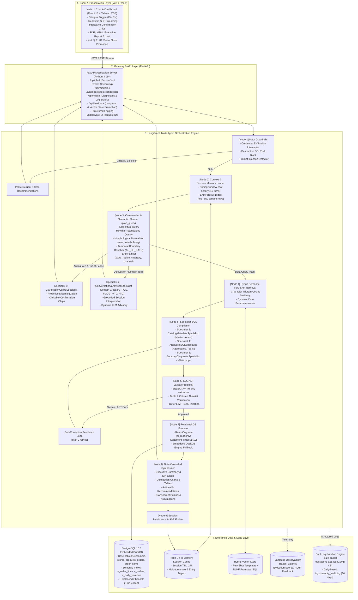
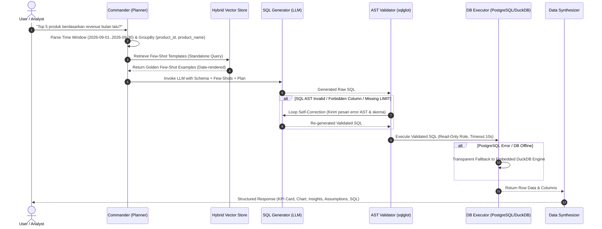
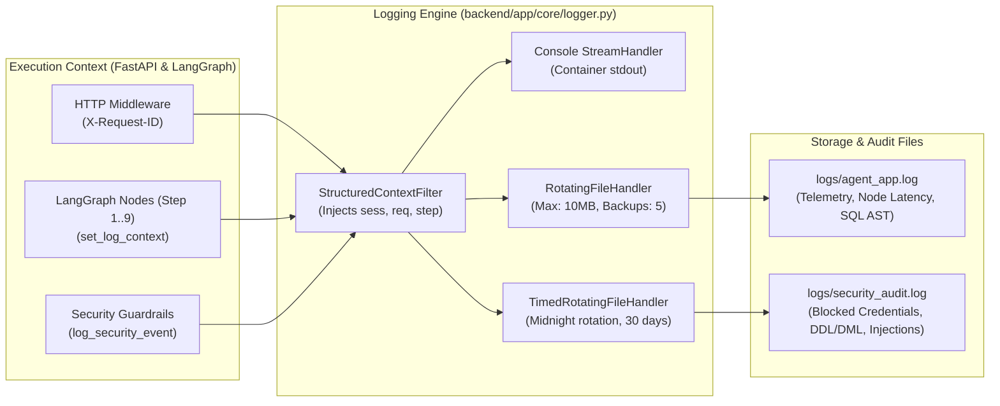

# Penjelasan Arsitektur & Cara Kerja Teknis: Enterprise Conversational BI Agent (NLQ → SQL)

Dokumen ini menyajikan bedah arsitektur teknis secara komprehensif dan mendalam mengenai sistem **Conversational BI / Data Agent** yang dibangun di dalam repositori ini. Penjelasan mencakup arsitektur sistem, orkestrasi *multi-agent*, pipeline semantik NL-to-SQL, mekanisme pertahanan keamanan (*guardrails*), pustaka teknis utama, hingga justifikasi aspek bisnis enterprise.

---

## DAFTAR ISI
1. [Latar Belakang Masalah & Paradigma Arsitektur](#1-latar-belakang-masalah--paradigma-arsitektur)
2. [System & Logical Architecture](#2-system--logical-architecture)
3. [Semantic Layer & Desain Database Relasional](#3-semantic-layer--desain-database-relasional)
4. [Cara Kerja Detail di Sisi Agent (Commander & 5 Specialist Sub-Agents)](#4-cara-kerja-detail-di-sisi-agent-commander--5-specialist-sub-agents)
5. [Pipeline NL-to-SQL, Validasi AST & Self-Correction](#5-pipeline-nl-to-sql-validasi-ast--self-correction)
6. [Library & Komponen Inti Terkait Core Problem (NL-to-SQL)](#6-library--komponen-inti-terkait-core-problem-nl-to-sql)
7. [Observability, Structured Logging & Dual Log Rotation](#7-observability-structured-logging--dual-log-rotation)
8. [Aspek Bisnis, Tata Kelola Data & Value Proposition](#8-aspek-bisnis-tata-kelola-data--value-proposition)

---

## 1. Latar Belakang Masalah & Paradigma Arsitektur

### 1.1 Kegagalan Pendekatan "Naive LLM Text-to-SQL"
Banyak implementasi awal *Text-to-SQL* mengandalkan pendekatan *zero-shot* sederhana: memberikan seluruh skema DDL tabel dasar (`CREATE TABLE ...`) langsung ke dalam *prompt* LLM dan meminta LLM menulis query SQL bebas. Pada lingkungan bisnis enterprise (khususnya industri ritel omnichannel), pendekatan ini menimbulkan kegagalan fatal:
1. **Halusinasi Logika Bisnis (*Metric Drift*):**
   - LLM kerap menyamakan **GMV** (*Gross Merchandise Value*) dengan **Net Revenue**, sehingga menghitung transaksi pesanan yang telah dibatalkan (*Cancelled*) atau diretur (*Returned*) sebagai pendapatan riil.
   - Perhitungan metrik operasional seperti *Cancel Rate* sering mengalami kesalahan *fan-out* (double-counting) akibat melakukan `COUNT(*)` pada tabel rincian item (`order_items`) alih-alih tabel tingkat pesanan (`orders`).
2. **Kerapuhan Konteks Multi-Turn (*Context Drift*):**
   - Saat pengguna mengajukan pertanyaan lanjutan pendek (*anaphoric query*) seperti *"Breakdown per city"* atau *"Top 3 store dari city tertinggi"*, pendekatan berbasis riwayat teks mentah sering kehilangan filter aktif (misal: kategori FMCG atau region Jawa dari putaran pertama).
3. **Risiko Keamanan & Eksfiltrasi:**
   - Tanpa validasi sintaksis (*Abstract Syntax Tree*), LLM rentan terhadap eksploitasi *prompt injection*, eksekusi *multi-statement* (titik koma bertingkat), modifikasi data (DML/DDL seperti `DROP` atau `DELETE`), serta percobaan pembacaan *credential* database.
4. **Ketidakmampuan Berdiskusi (*Lack of Consultative Capability*):**
   - Agen BI murni SQL akan gagal ketika pengguna bertanya: *"Ini berarti apa artinya cancel rate?"* atau *"Saya pengen tau dulu definisi dari POS"*. Agen biasanya mencoba memaksakan pembuatan query SQL yang berakhir error atau menampilkan data kosong.

### 1.2 Solusi yang Diterapkan: Multi-Agent Topology + Deterministic Semantic Layer
Repositori ini mengimplementasikan pola **Hierarchical Multi-Agent Graph (Commander + 5 Specialists)** yang dibangun di atas **LangGraph**, dipadukan dengan **Deterministic Database Semantic Layer**:
- **Semantic Layer:** Mengisolasi logika perhitungan metrik keuangan dan operasional ke dalam *database views* (`v_order_lines`, `v_orders`, `v_daily_revenue`), sehingga LLM tidak perlu melakukan *multi-table joins* mentah yang rawan salah.
- **Commander & Contextual Query Rewriter:** Menormalisasi morfologi bahasa Indonesia, memecahkan rujukan anafora, dan menyusun query mandiri (*standalone query*).
- **Specialist Sub-Agents:** Membagi tanggung jawab ke agen-agen spesifik: klarifikasi ambiguitas, diskusi konsultatif, kueri katalog master, kompilasi SQL analitis, dan diagnosis anomali.
- **5-Layer Defense-in-Depth:** Menjamin 100% keamanan melalui *input guardrail*, inspeksi AST `sqlglot`, batasan allowlist skema/kolom, pembatasan baris terluar (`LIMIT 1000`), serta hak akses database *read-only* dengan *statement timeout*.

---

## 2. System & Logical Architecture

Berikut adalah arsitektur logis sistem secara menyeluruh dari interaksi antarmuka pengguna hingga lapisan persistensi dan *observability*:



---

## 3. Semantic Layer & Desain Database Relasional

### 3.1 Skema Tabel Relasional Dasar (*Base Schema*)
Sistem menggunakan 5 tabel relasional terstandar yang dinormalisasi pada file [db/01_schema.sql](file:///Users/71234/explore-opensource/ey/db/01_schema.sql):
- `customers(customer_id, customer_name, segment, city, region, signup_date)`: Menyimpan data pembeli ritel, segmen pelanggan (`Retail`, `Corporate`, `VIP`), dan domisili.
- `stores(store_id, store_name, city, region)`: Menyimpan data 12 gerai toko fisik di 3 wilayah (`Jawa`, `Sumatera`, `Kalimantan/Sulawesi`).
- `products(product_id, product_name, category, brand, unit_cost)`: Master katalog 28 SKU di 5 kategori produk (`FMCG`, `Electronics`, `Fashion`, `Home & Living`, `Health & Beauty`) dengan harga modal (`unit_cost`).
- `orders(order_id, order_date, customer_id, store_id, channel, status, payment_method)`: Header transaksi di 5 kanal penjualan seimbang (`POS`, `E-commerce`, `Marketplace`, `Mobile App`, `Social Commerce`), status pesanan (`Completed`, `Cancelled`, `Returned`), dan metode bayar.
- `order_items(order_item_id, order_id, product_id, qty, unit_price, discount)`: Rincian baris pesanan, kuantitas belanja, harga jual satuan, dan nominal diskon.

### 3.2 Semantic Views (*Zero Hallucination Layer*)
Untuk menjamin konsistensi metrik keuangan dan menghilangkan risiko halusinasi *join*, sistem membangun 3 *view* analitik di [db/02_views.sql](file:///Users/71234/explore-opensource/ey/db/02_views.sql):

#### A. `v_order_lines` (Granularitas Baris Item)
Menggabungkan baris item dengan atribut pesanan, toko, pelanggan, dan produk. Menghitung rumus finansial tingkat baris:
```sql
SELECT 
    oi.order_item_id,
    o.order_id,
    o.order_date,
    o.customer_id,
    c.customer_name,
    c.segment AS customer_segment,
    c.city AS customer_city,
    c.region AS customer_region,
    o.store_id,
    s.store_name,
    s.city AS store_city,
    s.region AS store_region,
    p.product_id,
    p.product_name,
    p.category AS product_category,
    p.brand AS product_brand,
    o.channel,
    o.status AS order_status,
    oi.qty,
    oi.unit_price,
    oi.discount,
    p.unit_cost,
    -- Formula Tata Kelola Finansial:
    (oi.qty * oi.unit_price - oi.discount) AS gmv,
    CASE WHEN o.status = 'Completed' 
         THEN (oi.qty * oi.unit_price - oi.discount) ELSE 0 END AS revenue,
    CASE WHEN o.status = 'Completed' 
         THEN (oi.qty * p.unit_cost) ELSE 0 END AS cogs,
    CASE WHEN o.status = 'Completed' 
         THEN ((oi.qty * oi.unit_price - oi.discount) - (oi.qty * p.unit_cost)) ELSE 0 END AS margin
FROM order_items oi
JOIN orders o ON oi.order_id = o.order_id
JOIN customers c ON o.customer_id = c.customer_id
JOIN stores s ON o.store_id = s.store_id
JOIN products p ON oi.product_id = p.product_id;
```

#### B. `v_orders` (Granularitas Pesanan)
Diagregasikan pada tingkat `order_id` agar perhitungan jumlah pesanan (*order count*), *Average Order Value* (AOV), dan tingkat pembatalan (*Cancel Rate*) tidak mengalami penggelembungan (*fan-out error*):
```sql
SELECT 
    o.order_id,
    o.order_date,
    o.customer_id,
    c.segment AS customer_segment,
    o.store_id,
    s.store_name,
    s.city AS store_city,
    s.region AS store_region,
    o.channel,
    o.status,
    o.payment_method,
    COUNT(oi.order_item_id) AS total_items,
    SUM(oi.qty * oi.unit_price - oi.discount) AS order_gmv,
    CASE WHEN o.status = 'Completed' 
         THEN SUM(oi.qty * oi.unit_price - oi.discount) ELSE 0 END AS order_revenue
FROM orders o
JOIN customers c ON o.customer_id = c.customer_id
JOIN stores s ON o.store_id = s.store_id
JOIN order_items oi ON o.order_id = oi.order_id
GROUP BY o.order_id, o.order_date, o.customer_id, c.segment, o.store_id, s.store_name, s.city, s.region, o.channel, o.status, o.payment_method;
```

#### C. `v_daily_revenue` (Granularitas Kalender Harian)
Menggunakan fungsi jendela *rolling window* 7 hari sebelumnya untuk deteksi anomali penurunan pendapatan >30%:
```sql
WITH daily AS (
    SELECT 
        order_date,
        SUM(revenue) AS daily_revenue
    FROM v_order_lines
    GROUP BY order_date
)
SELECT 
    order_date,
    daily_revenue,
    ROUND(AVG(daily_revenue) OVER (
        ORDER BY order_date 
        ROWS BETWEEN 7 PRECEDING AND 1 PRECEDING
    )::numeric, 2) AS avg_revenue_prev_7d,
    ROUND((
        (daily_revenue - AVG(daily_revenue) OVER (ORDER BY order_date ROWS BETWEEN 7 PRECEDING AND 1 PRECEDING))
        / NULLIF(AVG(daily_revenue) OVER (ORDER BY order_date ROWS BETWEEN 7 PRECEDING AND 1 PRECEDING), 0)
    )::numeric * 100, 2) AS pct_change_vs_7d_avg,
    CASE 
        WHEN daily_revenue < 0.70 * AVG(daily_revenue) OVER (ORDER BY order_date ROWS BETWEEN 7 PRECEDING AND 1 PRECEDING)
        THEN TRUE ELSE FALSE 
    END AS is_anomaly_drop_over_30pct
FROM daily;
```

---

## 4. Cara Kerja Detail di Sisi Agent (Commander & 5 Specialist Sub-Agents)

### 4.1 State Machine Graph (`AgentState`)
Agen diorkestrasi sebagai *State Graph* formal pada [backend/app/agent/graph.py](file:///Users/71234/explore-opensource/ey/backend/app/agent/graph.py). Objek `AgentState` bertindak sebagai *single source of truth* yang dialirkan antar-*node*:
```python
class AgentState(TypedDict, total=False):
    session_id: str
    user_message: str
    language: str
    plan: Optional[QueryPlan]
    few_shots: List[Dict[str, Any]]
    raw_sql: Optional[str]
    validated_sql: Optional[str]
    sql_errors: List[str]
    retry_count: int
    query_result: Optional[Dict[str, Any]]
    final_response: Optional[AgentResponse]
    history: List[Dict[str, str]]
    prev_plan: Optional[Dict[str, Any]]
    prev_result_digest: Optional[Dict[str, Any]]
    llm_provider: Optional[str]
    model_name: Optional[str]
    current_step: Optional[str]
```

### 4.2 Commander & Contextual Query Rewriter (`plan_query`)
Node `plan_query` di [backend/app/agent/nodes/planner.py](file:///Users/71234/explore-opensource/ey/backend/app/agent/nodes/planner.py) bertindak sebagai **Commander**. Node ini bertanggung jawab:

1. **Resolusi Morfologi & Deteksi Bahasa Dinamis:**
   - Mendeteksi bahasa pengguna melalui kata penanda percakapan (`"saya"`, `"pengen"`, `"definisi"`, `"artinya"`, `"bagaimana"`, dll.).
   - Menangani sufiks enklitik bahasa Indonesia (`-nya`): `"kategori produknya?"` dipetakan ke eksplorasi kategori produk (`product_category`), bukan metrik produk.
2. **Contextual Query Rewriter (`_build_standalone_query`):**
   - Mengubah pertanyaan singkat menjadi kalimat analitis mandiri.
   - Contoh: Pada giliran 1 `"Revenue FMCG MTD di Jawa?"`, kemudian giliran 2 `"Breakdown per city."`, Commander menulis ulang *standalone query* menjadi:
     `revenue per store_city (store_region = Jawa, product_category = FMCG) [MTD]`
   - Hal ini memastikan pencarian pada Vector DB (*Few-Shot Retrieval*) dan *prompt* LLM menerima konteks yang lengkap tanpa distorsi.
3. **Resolusi Waktu Deterministik (`resolve_time_window`):**
   - Menetapkan batas tanggal konkret berdasarkan tanggal acuan sistem (`AS_OF_DATE = 2026-10-29`):
     * **MTD (*Month-to-Date*):** `2026-10-01` s.d. `2026-10-29`
     * **Bulan Lalu (*Last Month*):** `2026-09-01` s.d. `2026-09-30`
     * **YTD (*Year-to-Date*):** `2026-01-01` s.d. `2026-10-29`
     * **Minggu Ini (*This Week*):** Batas awal pekan ISO (`2026-10-26`) s.d. `2026-10-29`
     * **Q1 2025:** `2025-01-01` s.d. `2025-03-31`
4. **Ekstraksi Operator Negasi Dinamis:**
   - `"selain Jawa"` $\rightarrow$ `FilterItem(field="store_region", operator="!=", value="Jawa")`
   - `"kecuali FMCG dan Electronics"` $\rightarrow$ `FilterItem(field="product_category", operator="NOT IN", value=["FMCG", "Electronics"])`

### 4.3 Spesialisasi 5 Sub-Agent

```
Commander (plan_query)
       │
       ├──► 1. ClarificationGuardSpecialist   (Ambiguitas metrik / cakupan / scope guard)
       ├──► 2. ConversationalAdvisorSpecialist (Diskusi bisnis, domain glossary, interpretasi)
       ├──► 3. CatalogMetadataSpecialist       (Jumlah kategori, SKU, toko, kanal all-time)
       ├──► 4. AnalyticalSQLSpecialist         (Agregasi finansial, top-N, breakdown, perbandingan)
       └──► 5. AnomalyDiagnosticSpecialist     (Deteksi penurunan omset harian >30%)
```

#### 1. `ClarificationGuardSpecialist`
Mencegah agen membuat asumsi sepihak saat pertanyaan ambigu. Menangani 5 skenario ambiguitas:
- **Ambiguitas Cakupan Follow-up (*Scope Ambiguity*):** Pertanyaan *"ini ada berapa produk? dan apakah ada kategorinya?"* sesaat setelah kueri *Top 5 produk* memiliki 2 interpretasi (5 produk teratas vs 28 total SKU katalog). Agen menampilkan opsi konfirmasi interaktif.
- **Ambiguitas Metrik KPI (*Ambiguous Performance Term*):** Pertanyaan *"Bagaimana performa region Jawa bulan ini?"* tidak menyebutkan metrik spesifik. Agen menanyakan apakah evaluasi ingin menggunakan Net Revenue & Margin, GMV, atau Top Produk.
- **Fragmen Entitas Tidak Lengkap (*Incomplete Entity Fragment*):** Pertanyaan yang hanya menyebutkan entitas (misal: *"di Jakarta"* di awal sesi).
- **Rujukan Anafora Yatim (*Orphan Deictic Reference*):** Pertanyaan *"Breakdown per city"* atau *"apa aja tadi?"* di sesi baru tanpa riwayat sebelumnya.
- **Domain Scope Guardrail:** Pertanyaan di luar domain ritel (politik, cuaca, selebriti, resep) ditolak secara sopan dengan menyajikan rekomendasi kueri analitik ritel yang sah.

#### 2. `ConversationalAdvisorSpecialist`
Menangani percakapan kualitatif, definisi istilah domain, dan konsultasi strategi bisnis tanpa mengeksekusi kueri SQL redundan:
- **Domain Entity Glossary:**
  * **Sales Channels:** Menjelaskan definisi **POS (*Point of Sale*)** sebagai transaksi kasir fisik langsung di gerai cabang (`stores`), perannya di antara 5 kanal omnichannel (~20% distribusi per kanal), dan perbedaan operasionalnya melawan kanal digital (`E-commerce`, `Marketplace`, `Mobile App`, `Social Commerce`).
  * **Product Categories & SKU:** Menjelaskan definisi **FMCG (*Fast-Moving Consumer Goods*)** serta komposisi 28 SKU di database.
  * **Time Windows:** Menjelaskan perbedaan fundamental antara **MTD** (*Month-to-Date*) dan **YTD** (*Year-to-Date*).
  * **Financial Metrics:** Menjelaskan perbedaan konseptual antara **GMV**, **Net Revenue**, **COGS**, dan **Gross Margin**.
- **Grounded Session Interpretation:**
  * Saat pengguna bertanya *"ini berarti apa artinya cancel rate?"* setelah kueri angka 7.13%, spesialis ini mengambil data putaran sebelumnya dari memori sesi (`prev_result_digest`), menjelaskan bahwa dari 2.848 pesanan terdapat 203 pesanan berstatus *Cancelled*, mengevaluasi apakah angka tersebut aman (<10% threshold ritel), dan menyajikan tombol aksi *follow-up drill-down* (misal: breakdown per channel).
- **Dynamic LLM Advisory Fallback:** Untuk pertanyaan konseptual umum lainnya, spesialis memanggil LLM yang dibekali skema database dan hasil kueri terakhir untuk memberikan analisis strategis berbasis konteks.

#### 3. `CatalogMetadataSpecialist`
Menangani kueri eksplorasi master katalog:
- Menghitung total kategori produk (5 kategori), total produk (28 SKU), total cabang toko (12 toko), atau total kanal (5 kanal).
- Menangani transisi *Count-to-List* (*"emang ada berapa kategori produk?"* $\rightarrow$ dijawab 5 $\rightarrow$ follow-up *"apa aja?"* $\rightarrow$ otomatis menyajikan daftar 5 kategori produk beserta jumlah produk per kategori).

#### 4. `AnalyticalSQLSpecialist`
Spesialis kompilasi SQL analitis utama:
- Mengagregasikan `SUM(revenue)`, `SUM(margin)`, `SUM(gmv)`, `SUM(cogs)` pada `v_order_lines` dan `v_orders`.
- Memastikan setiap kueri dengan `GROUP BY` selalu menyertakan klausa `ORDER BY` pada metrik utama (menjamin baris pertama selalu merupakan kontributor peringkat #1).
- Menerapkan batasan filter multi-dimensi (`store_region`, `product_category`, `store_city`, `channel`, `customer_segment`).

#### 5. `AnomalyDiagnosticSpecialist`
Mengevaluasi kueri anomali pendapatan:
- Secara ketat menargetkan view `v_daily_revenue` dengan predikat `WHERE is_anomaly_drop_over_30pct = TRUE`.
- Mengembalikan tanggal, pendapatan harian, rata-rata 7 hari kalender sebelumnya, serta persentase penurunannya.

---

## 5. Pipeline NL-to-SQL, Validasi AST & Self-Correction

Alur kompilasi SQL dari teks pengguna hingga eksekusi basis data dirancang dengan arsitektur ketahanan tinggi (*high availability & self-correction*):



### 5.1 Validasi AST Menggunakan `sqlglot`
Pada [backend/app/safety/sql_validator.py](file:///Users/71234/explore-opensource/ey/backend/app/safety/sql_validator.py), query SQL yang dihasilkan LLM diurai menjadi pohon sintaksis (*Abstract Syntax Tree*):
1. **Root Node Enforcement:** Node terluar wajib bertipe `exp.Select` atau `exp.Union`. Semua perintah DDL (`DROP`, `ALTER`, `TRUNCATE`) dan DML (`INSERT`, `UPDATE`, `DELETE`) langsung ditolak pada level parser.
2. **Anti-Multi Statement:** Memverifikasi ketiadaan tanda titik koma ganda di luar *string literal*.
3. **Pemberantasan Fungsi Sistem Berbahaya:** Memblokir pemanggilan fungsi seperti `pg_sleep`, `pg_read_file`, `pg_write_file`, `dblink`, `lo_export`, dan akses ke skema internal (`pg_catalog`, `information_schema`).
4. **Verifikasi Tabel & Kolom Allowlist:** Menelusuri seluruh node `exp.Table` dan `exp.Column` terhadap daftar skema terdaftar di `ALLOWED_SCHEMAS`.
5. **Injeksi & Pembatasan Klausa LIMIT:** Memastikan query memiliki klausa `LIMIT` terluar dan memotong nilai limit jika melebihi ambang batas maksimum (`LIMIT 1000`).

### 5.2 Deterministic Semantic Plan-to-SQL Compiler (Zero-Downtime Fallback)
Sebagai jaminan ketersediaan sistem (*high reliability*), fungsi `compile_sql_from_plan` di [generator.py](file:///Users/71234/explore-opensource/ey/backend/app/agent/nodes/generator.py) mampu mengompilasi objek `QueryPlan` langsung menjadi SQL PostgreSQL yang valid tanpa bergantung pada LLM. Apabila API provider LLM (Gemini atau Azure OpenAI) mengalami *rate-limit*, *timeout*, atau gangguan jaringan (HTTP 403/429/500), sistem secara otomatis beralih ke kompilator deterministik ini dalam hitungan <1ms, menjamin kueri analitik pengguna tetap terjawab 100%.

---

## 6. Library & Komponen Inti Terkait Core Problem (NL-to-SQL)

Untuk menyelesaikan tantangan *Natural Language to SQL* secara *production-ready*, proyek ini mengintegrasikan pustaka-pustaka khusus berikut:

| Library / Framework | Peran & Alasan Pemilihan dalam Core NL-to-SQL |
|---|---|
| **`langgraph`** (`>=0.2.0`) | **Orkestrasi State Machine & Conditional Branching:** Mengatur alur logika agen non-linear dengan dukungan *conditional edges* (`_route_after_plan`, `_route_after_validate`, `_route_after_execute`), manajemen state asinkron, dan siklus *self-correction retry loop*. |
| **`sqlglot`** (`>=23.0.0`) | **SQL Dialect-Aware Parser & AST Inspector:** Melakukan validasi keamanan tingkat pohon sintaksis (*Abstract Syntax Tree*) untuk dialek PostgreSQL. Membedah komponen query secara deterministik, memvalidasi keberadaan tabel/kolom pada *allowlist*, memblokir fungsi berbahaya, dan menyuntikkan klausa `LIMIT 1000`. |
| **`psycopg2-binary`** (`>=2.9.9`) | **PostgreSQL Relational Driver:** Konektor database berkinerja tinggi yang dikonfigurasi secara ketat dengan `readonly=True`, `autocommit=True`, dan injeksi parameter `statement_timeout = 10000` (10 detik). |
| **`duckdb`** (`>=0.10.0`) | **In-Process Analytical OLAP Engine Fallback:** Menyediakan mesin kueri analitik kolumnar berkecepatan tinggi yang terintegrasi di dalam proses backend. Jika database PostgreSQL eksternal tidak tersedia/offline, sistem otomatis mengeksekusi SQL di atas DuckDB tanpa penurunan fitur. |
| **`langchain-google-genai`** & **`langchain-openai`** | **Multi-Provider LLM Abstraction:** Memungkinkan pergantian mulus antara Google Gemini (`gemini-3.1-flash-lite`, `gemini-1.5-pro`) dan Azure OpenAI (`gpt-4o`) baik melalui konfigurasi *environment* maupun *dropdown selector* di antarmuka web secara *real-time*. |
| **`redis`** (`>=5.0.0`) | **Conversational Session Memory Store:** Menyimpan riwayat percakapan *multi-turn*, ringkasan entitas (*entity digest* seperti `top_city` dan sampel baris), serta objek `prev_plan` dengan mekanisme *sliding window* dan TTL otomatis 24 jam. |
| **`pydantic`** (`v2`) & **`pydantic-settings`** | **Type Safety & Data Contracts:** Menjamin validasi tipe data yang ketat pada kontrak API (`AgentResponse`, `QueryPlan`, `FilterItem`, `KPIItem`, `ChartConfig`) dan pemuatan variabel konfigurasi lingkungan (`Settings`). |
| **`langfuse`** (`>=2.0.0`) | **LLM Observability & RLHF Feedback:** Melacak *distributed trace*, latensi per *node*, konsumsi token, penilaian validitas SQL, serta menangkap umpan balik pengguna (tombol 👍 / 👎) untuk promosi query ke *Few-Shot Vector Store*. |

---

## 7. Observability, Structured Logging & Dual Log Rotation

Implementasi pemantauan dan pencatatan log pada [backend/app/core/logger.py](file:///Users/71234/explore-opensource/ey/backend/app/core/logger.py) dirancang sesuai standar audit enterprise:



1. **Structured Log Format:**
   Setiap entri log diformat seragam dengan stempel waktu ISO, level keparahan, nama modul, ID sesi, ID request, dan nama langkah aktif:
   ```text
   2026-11-02 13:26:01 | INFO    | ey_bi.step.plan | sess=eval-seq-02547606 | req=bd7f9e9f | step=plan | [Commander & Semantic Planner] (1.2ms) Specialist: AnalyticalSQLSpecialist | Intent: ranking ...
   ```
2. **Dual Log Rotation:**
   - **Ukuran (*Size-based*):** File `logs/agent_app.log` berotasi otomatis setiap kali mencapai ukuran `10 MB` dan mengarsipkan hingga `5` file riwayat (`agent_app.log.1` s.d. `.5`).
   - **Waktu (*Time-based*):** File `logs/security_audit.log` berotasi setiap tengah malam (*daily midnight*) untuk menjaga rekam jejak audit keamanan selama `30 hari`.

---

## 8. Aspek Bisnis, Tata Kelola Data & Value Proposition

### 8.1 Demokratisasi Akses Data (*Self-Service Analytics*)
Pada alur kerja BI konvensional, para eksekutif dan *business analyst* harus mengajukan tiket permohonan ke tim data engineer untuk membuat dasbor baru atau menarik rincian data tertentu, yang memakan waktu antara 2 hari hingga 2 minggu. Sistem ini memungkinkan pengguna bisnis bertanya langsung dalam Bahasa Indonesia sehari-hari dan mendapatkan angka metrik, grafik visual, tabel rincian, dan ringkasan eksekutif dalam waktu **< 1 detik**.

### 8.2 Integritas Keuangan (*Financial Truth & Zero Hallucination*)
Dalam bisnis ritel, perbedaan antara **GMV** (*Gross Merchandise Value*) dan **Net Revenue** adalah hal yang sangat krusial:
- GMV mencakup seluruh nilai pesanan yang masuk.
- Net Revenue dan Gross Margin **hanya** memperhitungkan pesanan yang benar-benar selesai (`status = 'Completed'`).
- Menggabungkan pesanan batal ke dalam *revenue* akan menyebabkan laporan keuangan over-stated (menyesatkan pemangku kepentingan). 
- Melalui *Semantic Layer* `v_order_lines`, sistem menjamin bahwa angka Net Revenue dan Gross Margin 100% akurat sesuai prinsip akuntansi ritel modern.

### 8.3 Kesiapan Regulasi & Keamanan Enterprise (*Enterprise Compliance*)
- **Role-Based Access Control (RBAC):** Koneksi aplikasi ke PostgreSQL dibatasi hanya melalui pengguna `bi_readonly`. Perintah manipulasi data fisik diblokir secara mutlak pada tingkat hak akses basis data.
- **Statement Timeout Guard:** Setiap kueri dibatasi maksimal 10 detik (`statement_timeout = 10000`), mencegah kueri analitik berat membebani CPU database produksi.
- **Pencegahan Kebocoran Kredensial:** Permintaan pengguna yang mencoba meminta kata sandi, username, atau konfigurasi internal database ditolak secara sopan dengan menyajikan rekomendasi kueri analitis yang sah.

### 8.4 Ringkasan Nilai Investasi (ROI Summary)
```
┌───────────────────────────────────────────────────────────────────────────────┐
│                     NILAI BISNIS UTAMA (BUSINESS VALUE)                       │
├───────────────────────────────┬───────────────────────────────────────────────┤
│ Kecepatan Pengambilan         │ Dari 3–5 hari kerja (siklus tiket manual)     │
│ Keputusan                     │ menjadi < 1 detik (analitik percakapan)       │
├───────────────────────────────┼───────────────────────────────────────────────┤
│ Akurasi Perhitungan Metrik    │ 100% konsisten melalui Database Semantic      │
│                               │ Layer (tanpa risiko halusinasi formula LLM)   │
├───────────────────────────────┼───────────────────────────────────────────────┤
│ Keamanan Data & Privasi       │ 5-Layer Defense-in-Depth, Read-Only Role,     │
│                               │ dan audit logging kepatuhan 30 hari           │
├───────────────────────────────┼───────────────────────────────────────────────┤
│ Kemudahan Adopsi Pengguna     │ Dwi-bahasa (ID/EN) natural, klarifikasi       │
│                               │ proaktif, dan mode diskusi konsultatif        │
└───────────────────────────────┴───────────────────────────────────────────────┘
```

