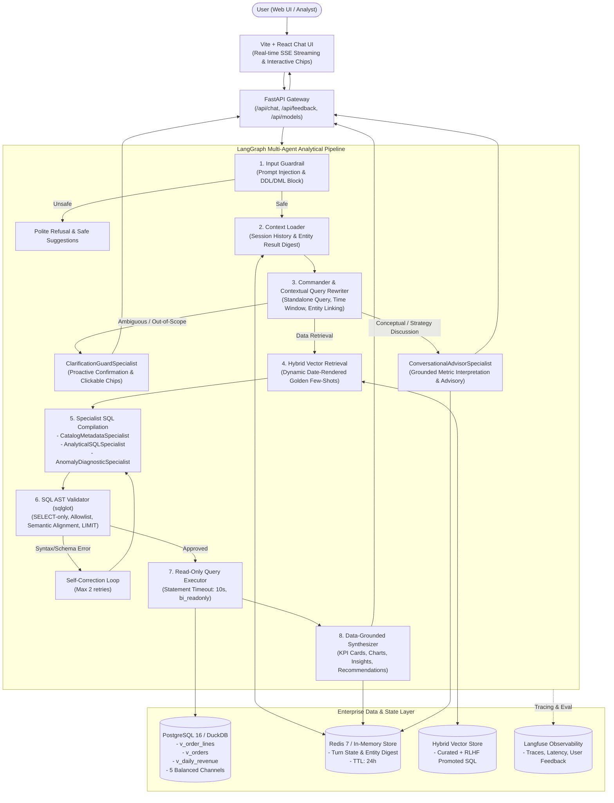

# Architecture Documentation: Enterprise Conversational BI Agent (NLQ → SQL)

## 1. System Overview
The Conversational BI Agent is an enterprise-grade multi-agent analytical system designed to translate natural language business questions (in Bahasa Indonesia and English) into safe, AST-validated, and highly performant PostgreSQL queries—while also supporting proactive disambiguation and interactive executive discussions.

It combines a **Commander + 5 Specialized Sub-Agents LangGraph Topology**, a **Semantic Layer (Pre-calculated Views)**, **Deterministic Time Resolvers**, **SQL AST Validation (`sqlglot`)**, **Read-Only Database Constraints**, and **Stateful Conversational Memory**.

---

## 2. Key Architecture Pillars

### 2.1 Commander + 5 Specialized Sub-Agents
Instead of a monolithic prompt, `plan_query` acts as the **Commander** that resolves time windows, links database entities (including negation operators `!=` and `NOT IN`), rewrites follow-ups into self-contained `standalone_query` strings, enforces the **OLAP Breakdown Invariant** (clearing redundant equality filters on grouping dimensions via `reconcile_olap_breakdown_filters()`), and routes execution to one of 5 specialists:
1. **`ClarificationGuardSpecialist`:** Handles 5 ambiguity classes (*Scope Ambiguity on Follow-Up*, *KPI Metric Ambiguity*, *Incomplete Entity Fragment*, *Orphan Deictic Reference*, and *Out-of-Scope Guardrail*) by returning interactive confirmation options.
2. **`ConversationalAdvisorSpecialist`:** Handles conceptual questions (*"Ini berarti apa artinya cancel rate?"*, *"Apa bedanya GMV sama Net Revenue?"*), benchmark evaluations (*"Apakah angka ini bagus atau bahaya?"*), and strategic brainstorming without executing redundant SQL queries.
3. **`CatalogMetadataSpecialist`:** Handles catalog-level count and listing queries (`category_count`, `product_count`, `store_count`, `channel_count`, and distinct entity exploration) over all-time scope.
4. **`AnalyticalSQLSpecialist`:** Compiles same-grain multi-metric co-aggregations, top-N rankings, dimensional breakdowns, and period comparisons over `v_order_lines` and `v_orders`, backed by a post-LLM semantic alignment guardrail and projection-to-order reconciliation.
5. **`AnomalyDiagnosticSpecialist`:** Targets `v_daily_revenue` to isolate dates where daily revenue dropped by `>30%` relative to the preceding 7-day rolling window average.

### 2.2 The Semantic Layer (Zero Hallucination of Business Metrics)
Rather than requiring the LLM to write error-prone raw joins across 5 base tables (`customers`, `stores`, `products`, `orders`, `order_items`), the system deploys pre-materialized **Semantic Views** governed by an **Active Metric Contract SSOT** (`schema_registry.py` and `metrics.yaml`):
- **Metric Contracts (`MetricContract`):** Defines canonical SQL expressions, output aliases, default sort directions, and grain view mappings for all 12 metrics (`gmv`, `revenue`, `margin`, `margin_pct`, `cogs`, `aov`, `cancel_rate`, `order_count`, `category_count`, `product_count`, `store_count`, `channel_count`).
- `v_order_lines`: Line-level pre-calculations:
  * `GMV = Σ(qty × unit_price − discount)` across all order statuses
  * `Net Revenue = Σ(qty × unit_price − discount)` strictly for `status = 'Completed'`
  * `COGS = Σ(qty × unit_cost)` strictly for `status = 'Completed'`
  * `Gross Margin = Net Revenue − COGS`
- `v_orders`: Order-level aggregations (prevents line-item fan-out when calculating Cancel Rate, Total Orders, and AOV).
- `v_daily_revenue`: 7-day rolling window average for deterministic anomaly detection.
- **Same-Grain Multi-Metric Co-Aggregation:** Enables single-scan SQL compilation when users ask compound metric questions within the same fact grain (e.g. product count + category count, or GMV + Revenue).
- **Projection-to-Order Reconciliation:** Automatically reconciles `ORDER BY` aliases with projected `SELECT` expressions, eliminating column hallucination errors before AST validation.

### 2.3 Layered Defense Guardrails (Security in Depth)
1. **L1 Input Guard:** Rejects instructions containing `DROP`, `DELETE`, `UPDATE`, prompt injections, or system prompt extraction.
2. **L2 AST Inspection (`sqlglot`):** Guarantees exactly 1 SQL statement, roots strictly on `SELECT` or `WITH`, blocks all destructive keywords and unsafe PostgreSQL functions (`pg_sleep`, `pg_read_file`, `dblink`).
3. **L3 Table & Column Allowlist:** Enforces that every table or view queried strictly belongs to the schema registry.
4. **L4 Semantic Alignment & LIMIT Guard:** Verifies that LLM-generated SQL matches the planned metrics, dimensions, and `ORDER BY` clauses, and caps all unbounded queries to `LIMIT 1000`.
5. **L5 Database Permissions:** The application connects through the `bi_readonly` role, with `default_transaction_read_only = on` and `statement_timeout = '10s'`.

### 2.4 Contextual State, Discussion Memory & RLHF Vector Promotion
- Multi-turn state (`prev_plan`, `prev_result_digest`, `entity_values`, `last_rows_sample`) is tracked per session in Redis (with automatic in-memory fallback).
- Engaging in an analytical discussion turn (`ConversationalAdvisorSpecialist`) preserves the active data context (`prev_plan` and `prev_result_digest`) so subsequent drill-downs (e.g., *"Breakdown per channel"*) seamlessly continue from the prior data query.
- Clicking 👍 in the UI invokes `POST /api/feedback`, promoting the verified question-SQL pair into the hybrid vector store (`add_verified_example`) and recording the user satisfaction score in Langfuse.

### 2.5 Structured Step Logging & Dual Log Rotation (`backend/app/core/logger.py`)
- **Correlation Context Propagation:** Uses Python `contextvars` to bind `session_id`, `request_id`, and `step_name` across FastAPI HTTP middleware and all 9 LangGraph execution steps.
- **Size-Based Application Log Rotation (`RotatingFileHandler`):** Writes structured step telemetry (`elapsed_ms`, specialist routing, SQL compilation, and DB execution latency) to `logs/agent_app.log` with automatic rotation at `10 MB` and `5` retained archives.
- **Daily Security Audit Log Rotation (`TimedRotatingFileHandler`):** Writes all guardrail interceptions (credential exfiltration, prompt injection, DDL/DML attempts, and `sqlglot` AST rejections) to `logs/security_audit.log`, rotating daily at midnight with `30` days of retention.

### 2.6 Cloud Portability & Azure Terraform IaC (`infra/terraform/`)
- **LLM Factory:** Switch between Google Gemini and Azure OpenAI at runtime via the UI selector or `LLM_PROVIDER`.
- **Database Resilience:** Full compatibility with **PostgreSQL 16** (including Azure Database for PostgreSQL Flexible Server) plus automatic zero-config fallback to an embedded **DuckDB** analytical engine when `DATABASE_URL` is not configured.
- **Session Store:** Standard Redis commands compatible with **Azure Cache for Redis**, with zero-downtime fallback to an in-memory session store.
- **Terraform Provisioning (`infra/terraform/`):** Declaratively provisions Azure Container Apps, Azure Container Registry, Azure Database for PostgreSQL 16 (`pgvector`), Azure Cache for Redis (TLS 1.2), Azure OpenAI (`gpt-4o`), Azure Key Vault, Managed Identity, and Azure Log Analytics Workspace.
