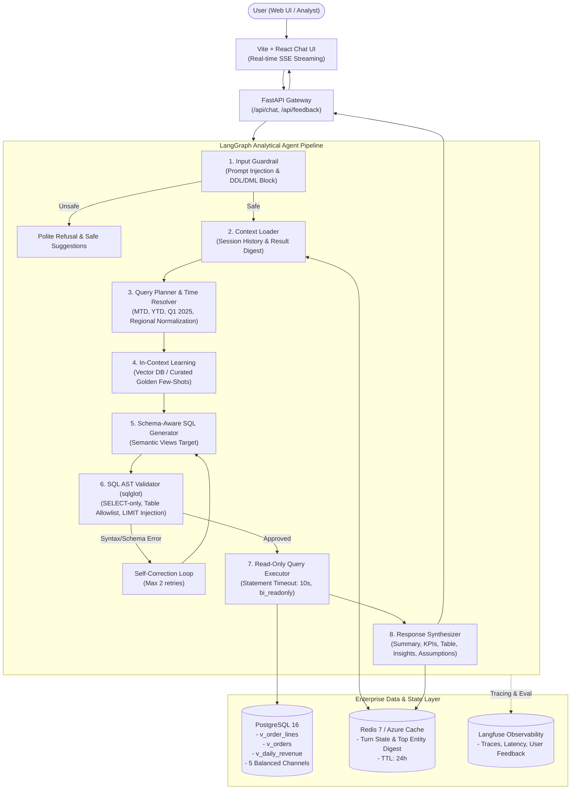

# Architecture Documentation: Conversational BI / Data Agent (NLQ → SQL)

## 1. System Overview
The Conversational BI Agent is an enterprise-grade analytical system designed to translate natural language business questions (Indonesian and English) into safe, validated, and highly performant PostgreSQL SQL queries.

It combines a **Semantic Layer (Pre-calculated Views)**, **Deterministic Time Resolvers**, **LangGraph Orchestration**, **SQL AST Validation**, **Read-Only Database Constraints**, and **Stateful Conversational Context**.

---

## 2. Key Architecture Pillars

### 2.1 The Semantic Layer (Zero Hallucination of Business Metrics)
Rather than requiring the LLM to write complex raw joins across 5 tables (`customers`, `stores`, `products`, `orders`, `order_items`), the system deploys pre-materialized **Semantic Views**:
- `v_order_lines`: Line-level pre-calculations:
  * $\text{GMV} = \Sigma(\text{qty} \times \text{unit\_price} - \text{discount})$
  * $\text{Revenue} = \text{GMV for status='Completed'}$
  * $\text{COGS} = \Sigma(\text{qty} \times \text{unit\_cost})\text{ for status='Completed'}$
  * $\text{Margin} = \text{Revenue} - \text{COGS}$
- `v_orders`: Order-level aggregations (prevents duplicate counting for Cancel Rate, Total Orders, AOV).
- `v_daily_revenue`: 7-day rolling window average for deterministic anomaly detection.

### 2.2 Layered Defense Guardrails (Security in Depth)
1. **L1 Input Guard:** Rejects instructions containing `DROP`, `DELETE`, `UPDATE`, prompt injections, or system prompt extraction.
2. **L2 AST Inspection (`sqlglot`):** Guarantees exactly 1 SQL statement, roots strictly on `SELECT` or `WITH`, blocks all destructive keywords and unsafe PostgreSQL functions (`pg_sleep`, `pg_read_file`, `dblink`).
3. **L3 Table & Column Allowlist:** Enforces that every table or view queried strictly belongs to the schema registry.
4. **L4 LIMIT Guard:** Caps all unbounded queries to `LIMIT 1000`.
5. **L5 Database Permissions:** The application connects exclusively through the `bi_readonly` role, with `default_transaction_read_only = on` and a strict `statement_timeout = '10s'`.

### 2.3 Contextual State & Follow-Up Chaining
- Multi-turn state is tracked in Redis (or in-memory fallback).
- Follow-up turns (e.g., *"Revenue FMCG MTD di Jawa?"* $\rightarrow$ *"Breakdown per city."* $\rightarrow$ *"Top 3 store dari city tertinggi."*) inherit previous filters, metrics, and extract the winning entity from the previous result digest without asking the user to repeat parameters.

### 2.4 Cloud Portability (Azure-Ready)
- **LLM Factory:** Switch from Gemini to Azure OpenAI seamlessly via `LLM_PROVIDER=azure_openai`.
- **Redis:** Uses pure standard Redis commands without custom modules, ensuring 100% out-of-the-box compatibility with **Azure Cache for Redis**.
- **Database:** Full standard SQL compatibility with **Azure Database for PostgreSQL - Flexible Server**.
- **Observability:** Compatible with Langfuse Cloud or self-hosted Langfuse.
